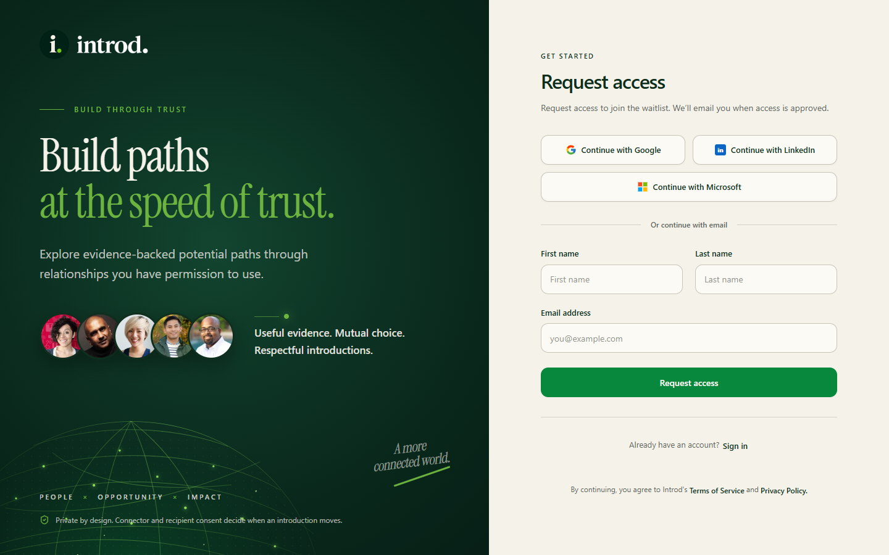
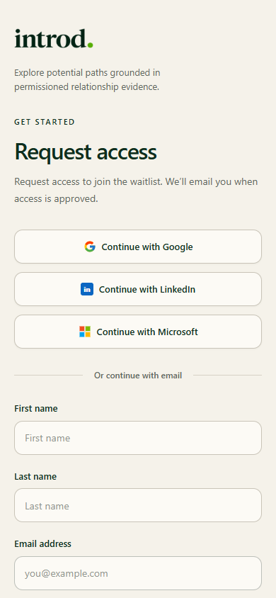

Open [Request access](https://app.getintrod.ai/sign-up).

> Last reviewed against current product source on October 30, 2026. The sign-up page copy was also confirmed on the live site.

## How access works

Introd access is approved before you can use a workspace. The sign-up page is titled **Request access** and says: "Request access to join the waitlist. We'll email you when access is approved."

Until your access is approved, signing in takes you to the **Access** page instead of the workspace. That page explains that Introd does not create public accounts without an approved invitation.

## Request access

1. Open [Request access](https://app.getintrod.ai/sign-up).
2. Enter your first name, last name, and email address, or choose Google, LinkedIn, or Microsoft.
3. Choose **Request access**.

**Expected result:** Introd records your request and shows a confirmation. You do not get a workspace yet.

<Frame caption="The Request access page on desktop.">
  
</Frame>

<Frame caption="The same page on a phone-width screen.">
  
</Frame>

## After you are approved

1. Open the invitation or activation link Introd emails you, or return to [Sign in](https://app.getintrod.ai/sign-in).
2. Complete activation on the **Access** page if it asks you to.
3. Choose a plan on **Choose your plan**. See [Plans and required setup](/getting-started/quickstart#2-choose-a-plan).
4. Connect and verify your first network source in [Network Setup](https://app.getintrod.ai/setup-network).

<Note>
  Introd has not published how quickly requests are reviewed or whether any request is approved automatically. If you have not heard back, email [help@getintrod.ai](mailto:help@getintrod.ai) from the address you used.
</Note>

## Sign in later

Use [Sign in](https://app.getintrod.ai/sign-in). Social providers and email sign-in are offered there. If your account has two-factor authentication turned on, Introd sends you to a two-factor challenge after sign-in. See [Settings](/workspace/settings).

Microsoft 365 and Google Workspace can also be connected later as relationship sources from [Integrations](https://app.getintrod.ai/settings/integrations). Signing in with a provider and connecting that provider as a source are separate steps.

## Failure states

| What you see | Recovery |
| --- | --- |
| You are sent to the Access page after signing in | Your access is not approved or activated yet. Check your email for an invitation, or email help@getintrod.ai |
| Provider callback returns an error | Return to Sign in and retry the same provider |
| Two-factor challenge appears | Enter the code from your authenticator app |
| You forgot your password | Use **Forgot password** on the sign-in page |

## Security notes

- Enter provider credentials only on the provider's own authentication page.
- Introd's extension never asks for your LinkedIn password.
- Never send a password, OAuth code, access token, or extension file to support.

For account help, email [help@getintrod.ai](mailto:help@getintrod.ai).
