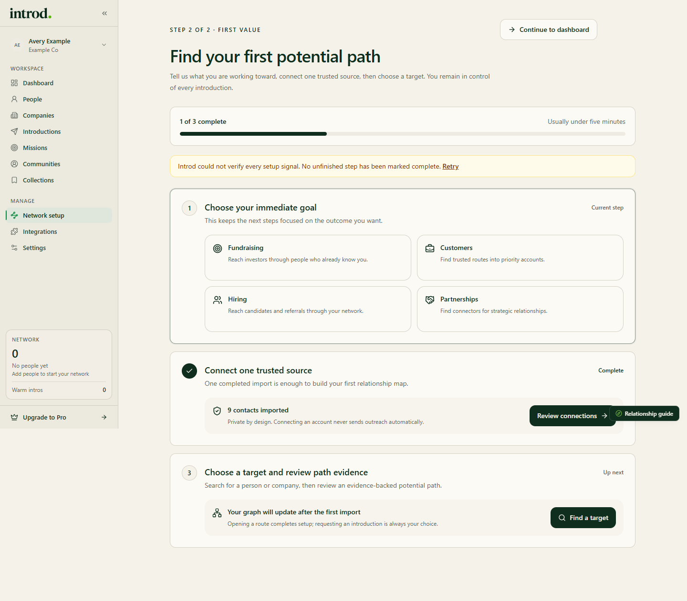

This guide ends with a reviewed path and a saved draft. Nothing in it contacts the person you want to meet.

> Last reviewed against current product source on October 30, 2026.

## Prerequisites

- An approved Introd account. If you do not have one yet, start with [Request access](/getting-started/create-account).
- One real network source you are authorized to use. Choose at least one:
  - **LinkedIn**, through the Introd Chrome extension (desktop Chrome and a LinkedIn session in the same Chrome profile)
  - **Google Workspace** or **Microsoft 365**, through provider consent
  - **A contacts CSV**, including a file exported from Apple Contacts
- One real person in your network to search for.

## 1. Request access

Open [Request access](https://app.getintrod.ai/sign-up), enter your details, and wait for the approval email. See [Request access](/getting-started/create-account).

## 2. Choose a plan

After approval, **Choose your plan** shows plan cards with a Monthly or Annual toggle.

| Choice | What the button says |
| --- | --- |
| Free | **Continue free — no card** |
| A paid plan with a trial | **Start N-day trial** |
| A paid plan without a trial | **Continue to checkout** |
| Community | **Continue with our team**, a sales-assisted plan |

Plan prices, trial length, and features come from Introd's billing system and can change, so this guide does not list them. Free includes LinkedIn sync with no card. On the Free plan, connecting Google Workspace or Microsoft 365 can require a paid plan or a connector add-on; Introd tells you when it does. See [Settings](/workspace/settings).

## 3. Finish required setup

Introd keeps a new account in setup until the first network source is verified. **Getting Started** asks for your goal (Fundraising, Customers, Hiring, or Partnerships) and offers **Continue to dashboard** if you choose to defer setup.

<Frame caption="Example data in the Introd dashboard. The notice about setup signals appears when Introd cannot verify every setup signal.">
  
</Frame>

On [Network Setup](https://app.getintrod.ai/setup-network), connect a source:

| Source | How it connects |
| --- | --- |
| LinkedIn | The Introd Chrome extension. See [Chrome extension](/chrome-extension) |
| Google Workspace | Google consent. See [Connect integrations](/getting-started/connect-integrations) |
| Microsoft 365 | Microsoft consent |
| Apple Contacts | Export your contacts and import the file as a CSV; there is no direct connection |
| CSV | Preview and import a spreadsheet. See [Import contacts](/setup-network/import-contacts) |

**Expected result:** the source shows a connected state or an imported count, and Introd lets you into the rest of the app.

## 4. Find a person

1. Open [People](https://app.getintrod.ai/search/people).
2. Search by name, title, or company.
3. Select a result to open its side panel.
4. Use the path action in the panel to review the path.

**Expected result:** Introd shows available paths and evidence, or a truthful empty or still-syncing state.

## 5. Review the path

On **Potential Intro Path**, read the connector, **Why this path works**, **Path Strength**, and **Path confidence**. If the evidence is weak or incomplete, choose another target or add more relationship data.

## 6. Prepare the introduction

1. Choose **Request intro** from the path, or start from **New introduction** on [Introductions](https://app.getintrod.ai/introductions).
2. Confirm the target and connector.
3. Edit the message. It can be up to 1,000 characters.
4. Choose **Save draft** to keep working, or continue to the connector review.

**Expected result:** Introd reports that the draft is saved. A saved draft contacts no one.

See [Prepare an introduction](/introductions/create-request) for what each action does.

## Common failure states

| What you see | Meaning | Recovery |
| --- | --- | --- |
| You land on the Access page | Access is not approved or activated | Check your email or contact help@getintrod.ai |
| You are returned to Network Setup | No source is verified yet | Connect and verify a source, or choose **Continue to dashboard** on Getting Started |
| A Google or Microsoft connection asks for a paid plan | Free plan connector limit | Choose a plan or add-on in Settings, or use LinkedIn or CSV |
| No people found | No synced contact matches | Check imported counts in Network Setup |
| No verified warm path | The graph has no usable connector evidence | Try another target or add more relationship data |

## Limitations

- Imported totals can be lower than LinkedIn's visible total.
- A completed sync does not guarantee a path to a particular person.
- Path scores are decision-support signals, not promises of an introduction or outcome.
- Introd never contacts the person you want to meet on its own.
