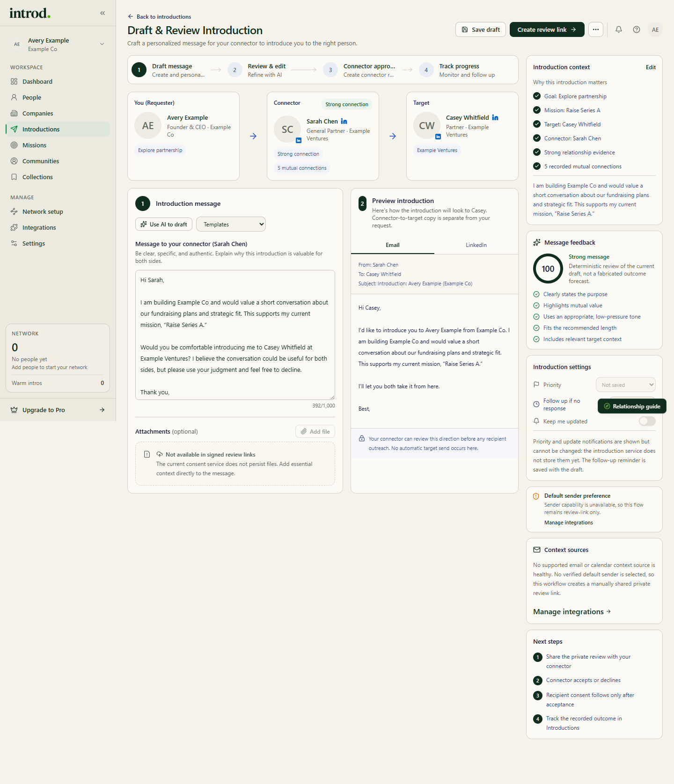
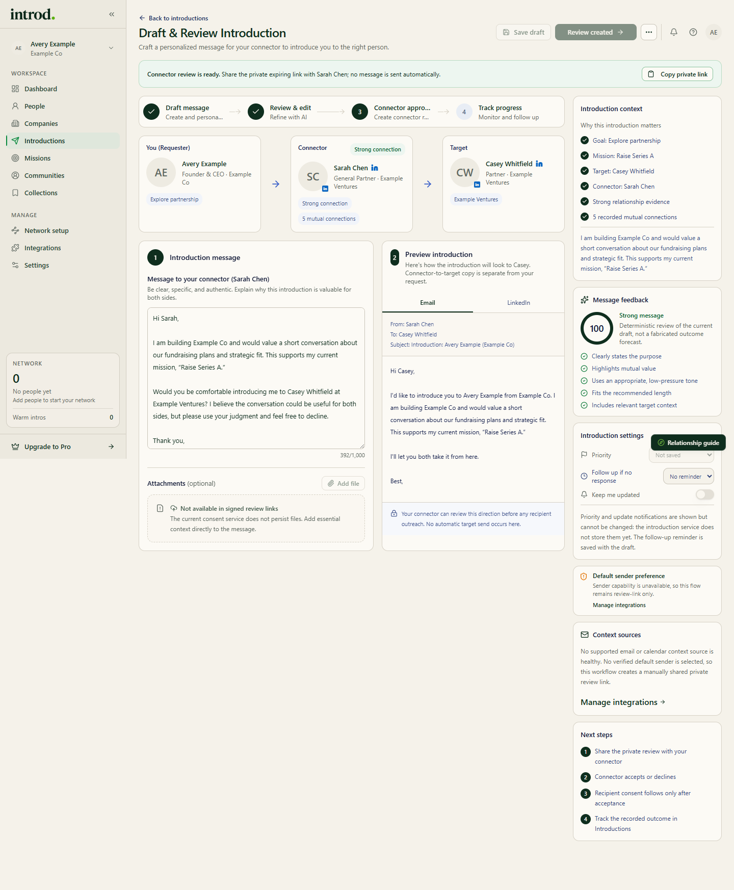
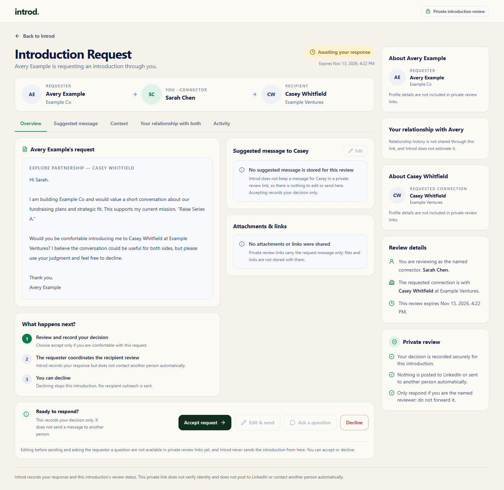

Start from **New introduction** on [Introductions](https://app.getintrod.ai/introductions), or from a person, path, mission, or collection.

> Last reviewed against current product source on October 30, 2026.

## The steps

The new-introduction flow has four steps: **Who** (select your target), **Why** (share context), **How** (review and send), and **Track** (follow progress). Choosing a target from a path pre-fills the target and proposed connector.

## Review the path and recipients

Before writing:

1. Confirm the target is the correct person.
2. Confirm the connector is someone you can appropriately ask.
3. Review the path explanation and any missing context.
4. Change or abandon the route if it does not match the relationship you understand.

## Edit the request

On **Draft & Review**, the steps are **Draft message**, **Review & edit**, **Connector approval**, and **Track progress**. The message can be up to 1,000 characters. Keep it easy to evaluate and forward:

- state who you want to meet;
- explain why the conversation is relevant now;
- include the minimum context the connector needs;
- make it easy to decline; and
- remove generated text or relationship claims you cannot verify.

**Use AI to draft** offers starter templates (**Concise request**, **Seek advice**, **Explore partnership**). Review and edit any generated text before using it. **Copy message** gives you a LinkedIn-ready copy.

<Frame caption="Example data in the Introd dashboard. Here no verified sender is selected, so the button reads Create review link.">
  
</Frame>

## Understand the actions

| Action | What it does |
| --- | --- |
| **Save draft** | Stores the draft. Introd shows **Draft saved**. |
| **Copy message** | Copies the message so you can use it elsewhere. |
| **Create review link** | Creates a private, expiring connector review link for you to share. Introd sends nothing. |
| **Send for review** | Starts connector review and tries to deliver it from your verified sender account. |
| **Copy private link** | Copies the connector review link. |
| **Cancel introduction** | Cancels the record in Introd. It does not retract anything already sent elsewhere. |

<Warning>
  None of these actions contacts the person you want to meet. After the connector accepts, Introd shows the next step. Record the introduction as made only after the connector actually sends it.
</Warning>

<Frame caption="Example data in the Introd dashboard.">
  
</Frame>

## What the connector sees

The connector gets a private review page titled **Introduction Request** with tabs for **Overview**, **Suggested message**, **Context**, **Your relationship with both**, and **Activity**. They can choose **Accept request** or **Decline**. **Edit & send** and **Ask a question** appear on the page but are not available yet. If they decline, the introduction stops and nothing is sent to the target. The page also explains what happens next and that they can decline.

<Frame caption="Example data in the Introd dashboard. The expiry date is shown on the page.">
  
</Frame>

## Not available yet

On the draft screen, **Priority**, **Keep me updated**, and **Add file** are shown but cannot be changed. Introd says why on screen: attachments are not available in signed review links, and update notifications and priority are not stored for introductions yet. A follow-up reminder is saved with the draft.

## Sending from your own account

To use **Send for review**, enable sending for a connected Google or Microsoft account. A connected account that is not send-enabled shows "Connected for relationship signals. Enable sending to deliver introductions from this account." Sending is a separate permission from the metadata sync. See [OAuth permissions](/privacy-security/oauth-permissions).

After creation, open [Track introduction requests](/introductions/track-requests) to verify the record and its status.
