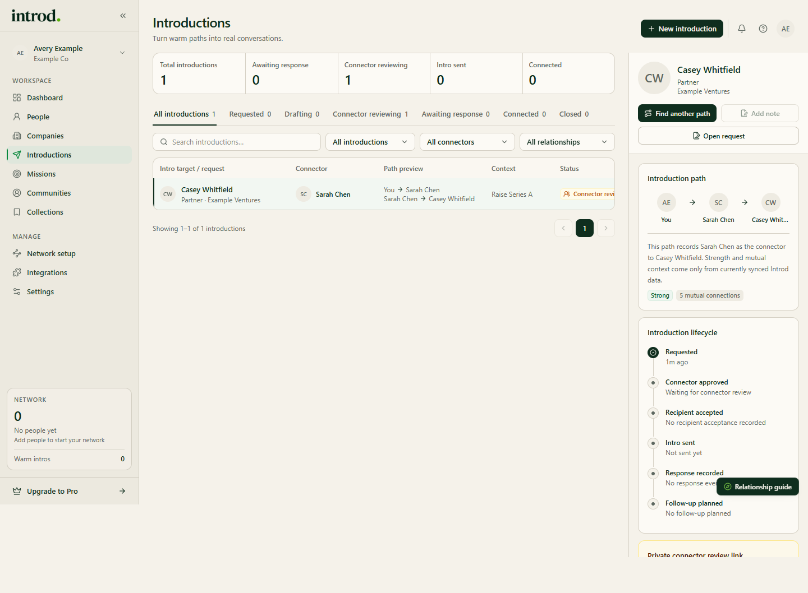

Open [Introductions](https://app.getintrod.ai/introductions) to review the workspace's stored introduction requests.

> Last reviewed against current product source on October 30, 2026.

## Find a record

- Search with **Search introductions…**, or use the filter menus for introductions, connectors, and relationships.
- Choose a tab: **All introductions**, **Requested**, **Drafting**, **Connector reviewing**, **Awaiting response**, **Connected**, or **Closed**.
- Select a record to open its side panel. It shows the introduction path, an **Introduction lifecycle** (Requested, Connector approved, Recipient accepted, Intro sent, Response recorded, Follow-up planned), and the actions **Find another path**, **Add note**, and **Open request**.

<Frame caption="Example data in the Introd dashboard.">
  
</Frame>

## Next action

Each record shows a **Next action**. When a review link was created, it reads along the lines of "Share the private connector review link with the connector. Nothing is sent automatically." Use **Private connector review link** or **Private recipient review link** to copy the link for that step.

When a record is waiting on the connector, wait for their decision. After the connector sends the introduction, record it in Introd.

## Update the workflow

Use **Add note** to keep context with a record. Use the archive action to cancel a request and remove it from active work. Archiving asks for confirmation.

<Warning>
  Status changes and archive actions update the Introd record only. They do not send, retract, or cancel a message in email, LinkedIn, or another external channel.
</Warning>

## When the page looks wrong

| Symptom | Check |
| --- | --- |
| No introductions | Clear the search and tab, then confirm a request was saved in this workspace |
| Missing target or connector | Open the record and confirm the source contact still exists |
| Unexpected status | Compare the stored status with the event you confirmed externally |
| Provider delivery status is unavailable | Introd does not infer delivery; check your sent mail or share the review link yourself |
| Load error | Refresh once; if it persists, contact [support](/support) with the page URL and approximate time |

For label definitions, see [Introduction statuses](/introductions/opportunity-flow).
