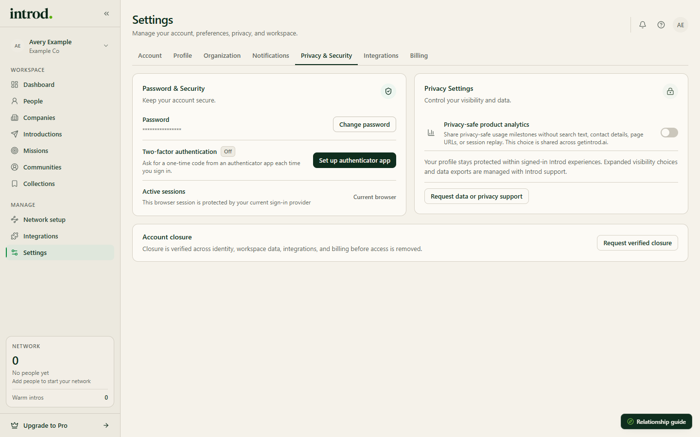

Disconnecting a provider, clearing an extension installation, and closing an Introd account have different effects.

> Last reviewed against current product source on October 30, 2026.

<Note>
  This page explains current product behavior, not legal advice. See the [Privacy Policy](https://getintrod.ai/legal/privacy) for the governing retention and rights terms.
</Note>

## Choose the action

| Your goal | Action | What remains |
| --- | --- | --- |
| Stop future Google or Microsoft sync | Disconnect the provider in Introd | Previously imported Introd records remain |
| Stop the extension syncing LinkedIn | Turn off **Enable extension** or choose **Revoke sync permission** in the extension | Connections already synced to Introd remain |
| Clear one extension installation | **Clear local data** in the extension Options page | Server-side Introd data and provider connections remain |
| Close your account | **Request verified closure** in Settings | An email request opens; Introd verifies it. Nothing is deleted by clicking it |
| Make a complete privacy request | Email privacy@getintrod.ai | Records allowed or required by the Privacy Policy can remain for the stated period |

## Disconnect Google Workspace or Microsoft 365

1. Open [Integrations](https://app.getintrod.ai/settings/integrations).
2. Open the connected provider card.
3. Choose **Disconnect** and confirm.

**Expected result:** future sync stops and Introd clears its stored connection. Imported Introd records are preserved.

Introd asks Google to revoke its grant when you disconnect a Google account. For Microsoft, remove Introd's access in your Microsoft account's app permissions as well. Use the provider's account controls to review or revoke consent at any time.

## Stop the extension or clear its data

In the extension's **Options page** (right-click the toolbar icon, then **Options**):

- **Revoke sync permission** removes your sync approval and local sync state. No new sync runs until you approve again.
- **Clear local data** (in **Danger zone**) removes the extension's saved data in this browser and signs you out.

Neither deletes data Introd already stored. See [Sync and consent](/chrome-extension/linkedin-integration).

## Close your account

<Frame caption="Example data in the Introd dashboard.">
  
</Frame>

1. Open [Settings](https://app.getintrod.ai/settings).
2. Choose **Request verified closure**.
3. Send the email that opens.

**Expected result:** Introd receives your request and verifies it. The product has no self-serve button that deletes your account.

For a data export, or for the scope and confirmation of what is deleted, use **Request data or privacy support** in Privacy Settings or continue with a privacy request.

## Submit a privacy request

Email [privacy@getintrod.ai](mailto:privacy@getintrod.ai) from the address associated with your Introd account. Include:

- the account email
- the request type, such as access, correction, or deletion
- any connected provider or extension installation relevant to the request
- enough non-secret context to identify the affected records

Do not include passwords, OAuth codes, access tokens, or extension files. Introd may request more information to verify the account first.

The current [Privacy Policy](https://getintrod.ai/legal/privacy) states that deletion or anonymization is completed within 30 days, subject to records retained for legal, fraud-prevention, security, or other stated obligations. It also states that backups are purged on a rolling 35-day cycle.

## What deletion does not do on its own

Disconnecting a source, revoking sync permission, and clearing local data do not remove people, relationships, or other records Introd has already stored. Only a verified privacy request addresses those. Introd does not publish a completion receipt for deletion inside the product, so ask for written confirmation.

## Failure states

| What you see | Next step |
| --- | --- |
| Provider says Disconnected but imported people remain | This is the documented disconnect result; submit a privacy request if deletion is required |
| Extension setup returns after local clear | Link it again only if you intend to reconnect that installation |
| You cannot access the account | Email privacy@getintrod.ai from the account address and explain the access problem |
| You do not receive a response | Retry the privacy address and include the original request date; do not resend secrets |
