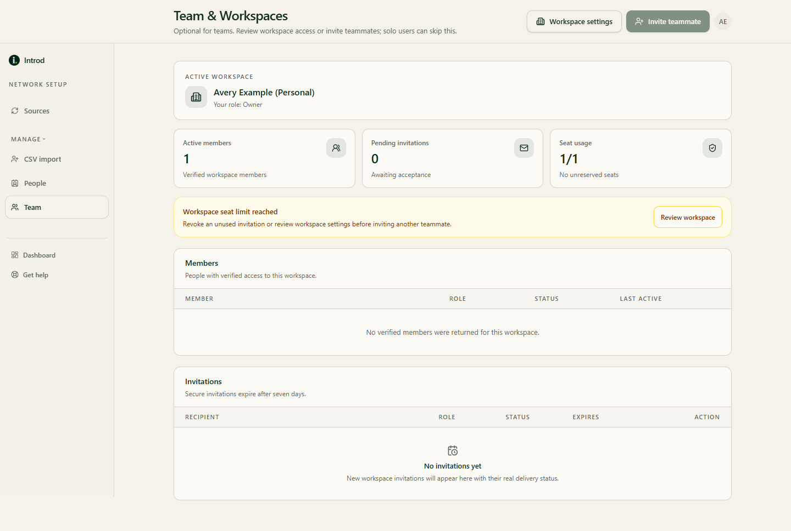

Team collaboration is optional. Solo users can skip this page.

[Open Team & Workspaces](https://app.getintrod.ai/setup-network/team)

> Last reviewed against current product source on October 30, 2026.

## What the page shows

**Team & Workspaces** shows your workspace's active members, pending invitations, and seat usage.

<Frame caption="Example data in the Introd dashboard. This workspace has one seat, so the invite button is unavailable.">
  
</Frame>

## Invite a teammate

1. Choose **Invite teammate**.
2. Enter the teammate's email address and, optionally, a personal note.
3. Choose **Send invitation**.

**Expected result:** Introd shows **Workspace invitation sent**. The invitation appears under pending invitations. Secure invitations expire after seven days. A teammate accepts it from the invitation link and sees a confirmation that they joined the workspace. Use **Revoke invitation** to cancel one that is still pending.

## Who can invite

Only workspace owners and admins can send or revoke invitations. Other members see "Member management is restricted: Only workspace owners and admins can send or revoke invitations."

Invitations add the person as a **member**. Workspace roles exist (owner, admin, member, and viewer), but the invite form offers member only.

## Seats

Your plan sets how many seats your workspace has. When you reach capacity, the invite button is disabled and shows "Workspace seat limit reached" with a **Review workspace** link. Upgrading to Team adds workspace members; extra seats are arranged through billing support. See [Settings](/workspace/settings).

## What teammates can see

Adding a teammate does not automatically share your network. Collections shared with the workspace show their people only while the collection's owner shares their network with the workspace. See [Collections](/workspace/collections).

## Related guides

- [Settings](/workspace/settings)
- [Privacy and security](/privacy-security)
