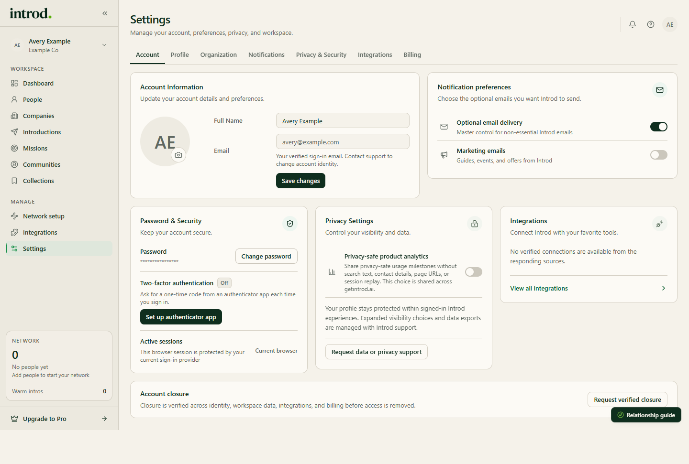

Settings contains account-level controls for your signed-in Introd workspace.

[Open Settings](https://app.getintrod.ai/settings)

> Last reviewed against current product source on October 30, 2026.

## Available sections

| Section | What is available |
| --- | --- |
| Account | Name, email, avatar (JPG, PNG, or WebP), and password change |
| Profile | A summary of your profile |
| Organization | Your billing workspace, the signed-in member, and links to Network Setup, Team & Workspaces, and Communities |
| Notifications | Optional email delivery, marketing emails, and essential updates |
| Privacy & Security | Privacy-safe product analytics, password, active sessions, and two-factor authentication |
| Integrations | Your LinkedIn status and a link to all integrations |
| Billing | Your plan, trial or payment status, and plan actions |

<Frame caption="Example data in the Introd dashboard.">
  
</Frame>

## Security

**Two-factor authentication** uses an authenticator app. Choose **Set up authenticator app** and follow the prompts. Once it is on, sign-in sends you to a two-factor challenge. **Active sessions** lists where your account is signed in.

## Privacy choices

Privacy Settings explains that expanded visibility choices and data exports are managed with Introd support, and offers **Request data or privacy support**. The analytics control covers privacy-safe product analytics. A consent banner also offers **Decline analytics**. For the policy governing personal data, see the [Introd Privacy Policy](https://getintrod.ai/legal/privacy).

## Billing

Plans are Free, Pro, Team, and Community. Prices, trials, and features come from Introd's billing system, so check the Billing section for current details. Only a workspace billing manager can change billing. Checkout and the billing portal are handled by Stripe. Community is sales-assisted.

If paid access ends, external syncs other than LinkedIn stop, and imported data remains visible and read-only.

## Close your account

Settings does not include a button that deletes your account. The **Account closure** section says closure is verified across identity, workspace data, integrations, and billing before access is removed. To start it, choose **Request verified closure**, which opens an email request to Introd.

<Warning>
  Requesting closure starts a conversation with Introd; it does not delete anything on its own. For access, correction, or deletion of your data, see [Deletion and privacy requests](/privacy-security/gdpr-and-deletion) or email [privacy@getintrod.ai](mailto:privacy@getintrod.ai). Data exports are handled by Introd support, so request one before you close your account.
</Warning>

## Related guides

- [Connect integrations](/getting-started/connect-integrations)
- [Privacy and security](/privacy-security)
- [OAuth permissions](/privacy-security/oauth-permissions)
